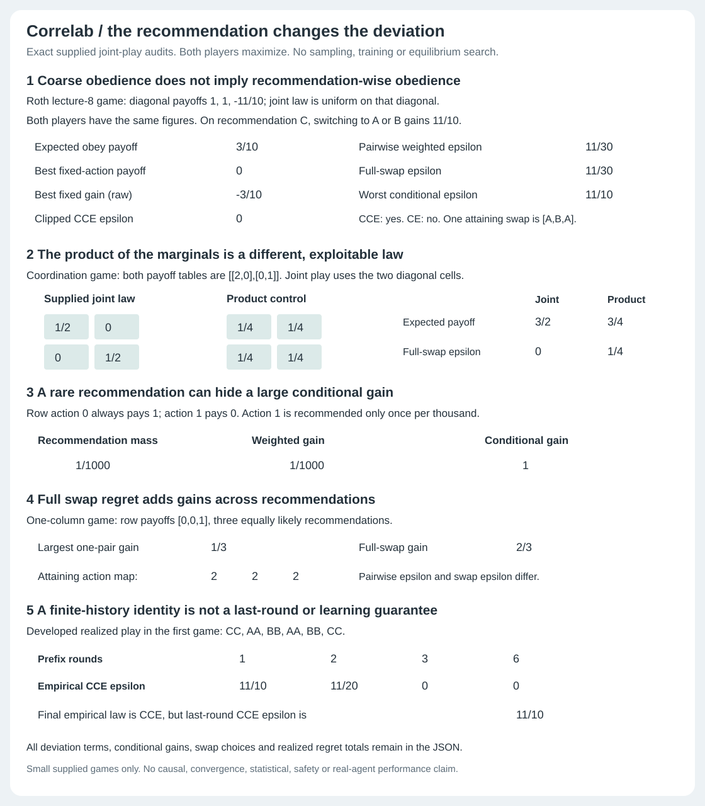
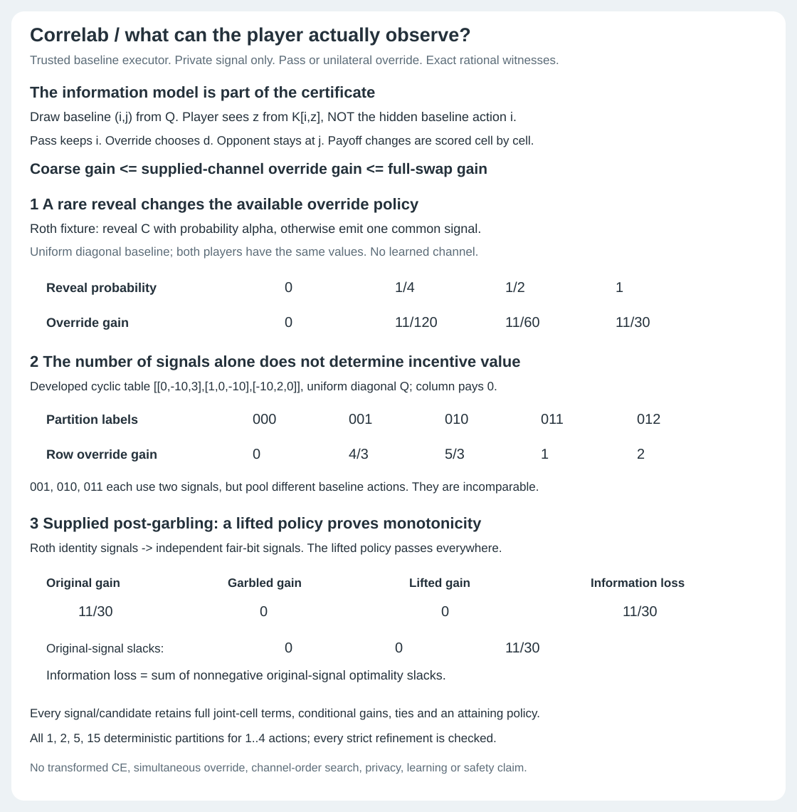

# Correlab

Audit a supplied joint play distribution in a small two-player general-sum
game. Correlab returns exact rational gains for fixed-action, recommendation-
conditioned and full-swap deviations, including an attaining action map.
A separate private-signal mode lets a player pass or override through a trusted
executor without separately seeing its baseline action.

The game, joint law and signal channel are inputs. This is not an equilibrium
search algorithm, a learner or a guarantee about real agents.



## Choose what the player knows

| Question | Command | Information available to the player |
| --- | --- | --- |
| Is the supplied law obedient? | `audit` | Its own recommendation; fixed-action, pairwise and full-swap gains remain distinct. |
| What holds for a realized history? | `history` | The same own-recommendation model, applied to empirical prefixes. |
| What can a noisy signal reveal? | `signals` | A private signal and a pass-or-override executor; not a separate view of the baseline action. |
| What changes after a supplied post-garbling? | `garble` | The coarser signal, with an explicit lifted policy and per-signal slack. |
| What do deterministic partitions reveal? | `partitions` | A partition of its own baseline action, with strict refinement comparisons. |

`demo` and `signal-demo` produce saved examples of the two models.

## Private override signals



What if a player sees only a noisy signal, rather than the baseline action?
The [private-signal proof and schema](SIGNALS.md) defines a trusted executor:
the player may pass or override, but its baseline action is not separately
revealed. Exact channel audits bridge clipped coarse gain and full-swap gain.
Supplied stochastic post-garblings include a lifted policy and nonnegative
per-signal slacks, not merely a numeric monotonicity check. All deterministic
own-action partitions through four actions retain full audits and every
strict refinement comparison.

The Roth control reveals C with probability `0, 1/4, 1/2, 1`, producing gains
`0, 11/120, 11/60, 11/30`. A developed cyclic control gives three different
gains `4/3, 5/3, 1` for three two-signal partitions of the same three actions.
This is a fixed unilateral decision problem, not CE of a changed game,
simultaneous overrides, information-order search, privacy or agent safety.

```
python -m correlab signal-demo
python -m correlab signals examples/signals-input.json
python -m correlab garble examples/garble-input.json
python -m correlab partitions examples/partitions-input.json
python examples/render_signals.py --check
```

## Why a single regret number can mislead

A supplied joint law can be coarse correlated equilibrium (CCE) while giving a player a profitable deviation after seeing their own recommendation. Replacing that law with the product of its marginals changes the object. A small weighted deviation can still conceal a large conditional incentive on a rare signal. Even pairwise internal regret and full-swap regret are different positive-epsilon conventions.

Correlab retains all fixed-action deviations, every recommendation/action pair with exact terms and conditional gains, all optimal swap choices and one attaining map with joint-cell contributions. Its production swap maximum separates by recommendation; tests independently enumerate every action map, including all 256 maps for four actions.

The [full proof, schema, source notes and limits](DESIGN.md) explain the four epsilon conventions and the information model. The [saved demo JSON](examples/demo.json) includes every witness, not only the figure's numbers.

## Run offline

Python 3.10+, standard library only. No model download, API key, service or paid dependency.

```sh
python -m correlab demo
python -m correlab audit examples/audit-input.json
python -m correlab history examples/history-input.json
python -m unittest discover -s tests -v
python examples/render_demo.py --check
```

```python
from correlab import audit, history
r = audit([[2, 0], [0, 1]], [[2, 0], [0, 1]],
          [["1/2", 0], [0, "1/2"]])
assert r["is_ce"] and not r["is_nash_product"]
assert not r["product_control"]["is_ce"]
```

Both payoff tables use row/column indexing. Both players maximize their own table; this is not a row-max/column-min scalar zero-sum solver. Probabilities sum exactly to one. Use integers, Fraction objects or exact rational/decimal strings, never floats or bools. One to four actions per side; histories have at most 1,000 realized joint actions and 100 explicit checkpoints.

## Controls that distinguish the concepts

- **CCE is weaker than CE.** The uniform diagonal law in Roth's lecture-8 game pays 3/10 per player. Every fixed-action deviation loses at least 3/10, so clipped external regret is zero. Yet recommendation C admits conditional gain 11/10, weighted and full-swap gain 11/30. The game/law are explicitly attributed, not an original discovery.
- **Correlation is not its marginals.** A developed diagonal coordination law pays 3/2 and is CE. Its product-marginals control pays 3/4 and has swap regret 1/4, despite identical player marginals.
- **Rare signals matter.** Recommendation mass 1/1000 gives weighted gain 1/1000 and conditional gain 1. Zero-mass conditional values are null, not invented zeroes.
- **Pairwise is not full swap.** Three equally likely recommendations with row payoffs [0,0,1] give largest single-pair gain 1/3 but full-swap gain 2/3. The attaining action map is [2,2,2].
- **Empirical average is not last round.** A developed six-round history ends with an empirical CCE, but its last joint action has CCE epsilon 11/10. Prefix reports include exact realized/counterfactual totals and the identities connecting them to average regrets. This is finite arithmetic, not an implemented learner or convergence result.

## Checks and limits of the evidence

The 50 tests check the full witnesses, not only the largest gain:

- Original obedience: 2,835 game/law cases from 81 ternary 2x2 row tables and 35 quarter-grid laws, with a separately varied column table. Independent action-map enumeration checks the production maximum; 28 rectangular/larger controls reach 256 maps per player.
- Histories: all 256 length-four 2x2 histories at three prefixes. Other checks cover exact ties, zero recommendations, transforms/player exchange, replication, order, invalid inputs, CLI parity and unchanged inputs/RNG.
- Private signals: 8,505 channel audits, 28 rectangular/larger four-signal cases with up to 625 policies per player, and 243 post-garbling lift certificates.
- Figures: three tests bind the obedience figure's 36 numeric cells and full compressed report metadata, reject hidden-term tampering and require byte-exact regeneration. Both figures have regeneration checks.

CI runs Python 3.10 through 3.13. The wheel job compares all seven complete
CLI outputs outside the checkout; the original three CLI outputs and
obedience SVG remain unchanged by the separate signal mode.

These are finite arithmetic and implementation checks. They do not establish
learning convergence, agent strength or statistical generalization.

## Scope and attribution

Supplied finite bimatrix games and supplied exact joint laws or realized histories only. Epsilon values are payoff incentives, not geometric distance or statistical confidence. No equilibrium search, adaptive algorithm, causal experiment, training guarantee, general private-information game solver, real-agent strength, scalable mechanism optimizer or production-safety claim.

Established definitions from Blum-Mansour, Bonn, Roth, Barakat, Charles University and Hart-Mas-Colell are linked and reconciled in [DESIGN.md](DESIGN.md). The Roth CCE-not-CE fixture is adapted with exact arithmetic; other controls are developed examples. The source notes identify cost/payoff orientation differences and two displayed-text typos rather than inheriting them silently. MIT license.
